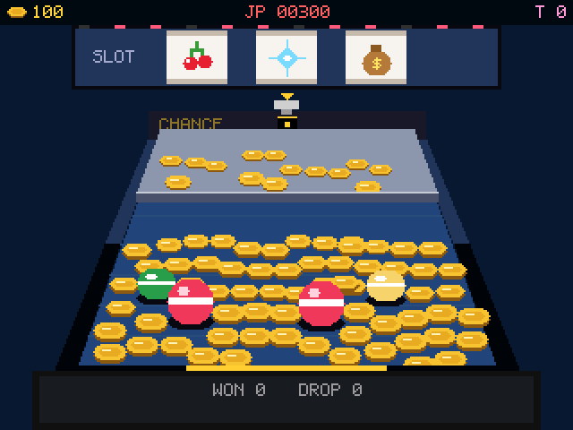

# 金幣嘉年華 Coin Carnival — AI Passport

An original coin pusher (推銀機) for the FoloToy AI Passport (ESP32-C3, 320×240, 3 keys), the 4th game after
Pip's Passport, Fire Brigade and Midnight Heist. **Virtual coins only**: no real money, no purchases, no cash-out.



**Status (Oct 2026):** flashed and verified on a real AI Passport (ota_1, hash verified, boots into the game);
title screen measured at a steady 30 fps (0 late frames, ~247 KB heap free); in-game fps under load still to be
read from the serial log. Published to the FoloToy AI Passport community as project **1136** (pending review).

## Play
| Key | In the machine |
|---|---|
| hold UP / DOWN | move the dropper (the first 0.15 s is fine aim) |
| tap OK | drop a coin |
| hold OK | rapid fire, 4 coins/s |
| hold the dropper against a side 1.5 s | pause menu |

Coins pushed over the middle of the front lip are yours; the side gutters and the corner holes keep the rest.
Coins through the moving **CHANCE** gate spin the slot (up to 4 held). 🍒 +2 coins, 🔔 +5, 💰 +10 tickets,
★ spins the wheel, 7-7-7 opens the **JACKPOT CHANCE** funnel. Push a bonus ball off to spin the wheel; push a
prize capsule off to collect it (+5 tickets, a full set of 6 +100). Spend tickets at the **PRIZE COUNTER** on
three more machines: CANDY FACTORY (150), SPACE STATION (400), DRAGON PALACE (900).

Pays about 50 % long-run like a real machine, but you never get stuck: +1 coin per 30 s while under 50, +20 when
everything has run dry, and **+30 coins for every 5 minutes of active play**.

## Build & flash (ota_1, next to the assistant)
```
. $IDF_PATH/export.sh                       # ESP-IDF v6
cp ../ai-passport-muse/esp32/dev_signing_key.pem .
idf.py set-target esp32c3 && idf.py build && idf.py size
tools/flash.sh -p /dev/cu.usbmodem* --boot  # app only; never idf.py flash
```
Progress and the whole coin pile are saved in NVS namespace `pusher` (`prog`, `field`).

## Tests
- `tools/shots/make_shots.sh`: host harness on the firmware's own code (33 checks, payout, screenshots → docs/).
- `tools/proto_test.sh`: the browser prototype `prototype/index.html` in headless Chrome (39 checks).

Design, research and numbers: [PLAN.md](PLAN.md).
